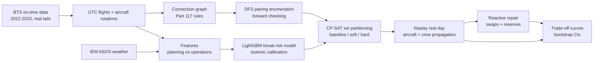

# robust-crew

**Delay-robust airline crew scheduling, tested by replaying the delays that actually happened.**

A crew schedule that is optimal on scheduled times is fragile: crews connect through tight turns, and one late inbound flight ripples through the rest of their day. This project asks whether you can buy robustness cheaply by (1) predicting the risk that each crew connection breaks, (2) feeding that risk into a classical set-partitioning optimizer, and (3) judging the result by re-flying real days of American Airlines operations at Charlotte (CLT) with their real delays. The deliverable is the trade-off curve between crews and propagated delay, not one number.

It extends a class report on constraint satisfaction for airline scheduling: the CSP core (pairing enumeration with forward checking) is the same idea, with machine learning and an honest out-of-sample replay added around it.

> **Crews are synthetic and crew rules are simplified.** The duty and flight-time limits use the values of FAA 14 CFR Part 117 Tables A and B, but rest rules, cumulative limits, extensions, deadheads and all contractual rules are omitted. Nothing here is a claim of legal or contractual compliance. Flights, aircraft rotations, delays and weather are real.

## Results

<!-- RESULTS:START -->
- **test summer** (62 days): with no repair, the selected soft-robust plan cuts crew-caused delay from 2568 to 2202 min/day (-14%) and broken connections from 45.3 to 38.5 for +0.1 crews/day. Reactive repair alone takes the baseline to 729 min/day; robust planning plus repair reaches 446 (paired Δ vs repair alone -283 [-492, -121] min/day).
- **test winter** (61 days): with no repair, the selected soft-robust plan cuts crew-caused delay from 1022 to 847 min/day (-17%) and broken connections from 26.5 to 20.8 for +0.3 crews/day. Reactive repair alone takes the baseline to 208 min/day; robust planning plus repair reaches 179 (paired Δ vs repair alone -30 [-45, -16] min/day).


<details><summary>Full tables with confidence intervals</summary>

Selected on CALIB days: soft λ = 2 (largest delay reduction with cost ≤ +2%); hard θ = 0.5.

Means per day with 95% bootstrap intervals over days in brackets; (Δ ...) is the paired difference vs the no-repair baseline on the same days, with its 95% interval. Hard robust is evaluated only on days it was feasible (its mean is over those days). Repair = reactive repair (idle-crew swaps + up to 4 reserves); reserves called count as crews used. Intervals over very few days are unreliable.

**All test days, test summer**

| Metric | Baseline | Best soft (Δ) | Best hard, paired days (Δ) | Baseline + repair (Δ) | Best soft + repair (Δ) |
|---|---|---|---|---|---|
| Crews used | 111.3 [109.9, 112.7] | 111.5 (+0.1 [+0.0, +0.2]) | 111.7 (+0.2 [+0.0, +0.3]) | 114.5 (+3.1 [+2.8, +3.4]) | 114.0 (+2.7 [+2.3, +3.0]) |
| Cost (pay hours) | 1176.9 [1155.7, 1195.5] | 1179.1 (+2.2 [+1.8, +2.7]) | 1179.2 (+0.8 [+0.2, +1.7]) | 1176.9 (+0.0 [+0.0, +0.0]) | 1179.1 (+2.2 [+1.8, +2.7]) |
| Crew-caused delay (min) | 2567.9 [1825.9, 3462.9] | 2201.8 (-366.2 [-556.1, -197.4]) | 2454.4 (+17.4 [-108.9, +143.4]) | 728.7 (-1839.3 [-2691.7, -1193.4]) | 445.5 (-2122.4 [-3001.9, -1424.3]) |
| Broken crew connections | 45.3 [40.8, 50.0] | 38.5 (-6.8 [-7.7, -5.8]) | 42.0 (+0.2 [-0.7, +1.1]) | 38.7 (-6.7 [-7.4, -5.9]) | 33.9 (-11.4 [-12.6, -10.3]) |
| Duty-limit violations | 11.7 [9.9, 13.7] | 12.1 (+0.4 [-0.2, +0.9]) | 10.8 (+0.0 [-0.6, +0.5]) | 10.2 (-1.5 [-1.8, -1.2]) | 10.8 (-0.9 [-1.5, -0.3]) |

Days: 62; hard feasible on 32 (52%).

**All test days, test winter**

| Metric | Baseline | Best soft (Δ) | Best hard, paired days (Δ) | Baseline + repair (Δ) | Best soft + repair (Δ) |
|---|---|---|---|---|---|
| Crews used | 106.0 [101.6, 109.9] | 106.3 (+0.3 [+0.2, +0.4]) | 105.7 (+0.1 [+0.0, +0.2]) | 107.5 (+1.5 [+1.2, +1.9]) | 107.5 (+1.5 [+1.2, +1.9]) |
| Cost (pay hours) | 1136.6 [1086.5, 1181.2] | 1139.3 (+2.8 [+2.2, +3.3]) | 1120.3 (+0.4 [+0.0, +1.0]) | 1136.6 (+0.0 [+0.0, +0.0]) | 1139.3 (+2.8 [+2.2, +3.3]) |
| Crew-caused delay (min) | 1021.5 [585.1, 1583.5] | 847.4 (-174.2 [-503.2, +81.3]) | 806.3 (-290.9 [-879.5, +17.4]) | 208.1 (-813.4 [-1355.8, -396.2]) | 178.5 (-843.0 [-1381.2, -420.8]) |
| Broken crew connections | 26.5 [23.3, 29.7] | 20.8 (-5.7 [-6.8, -4.6]) | 20.4 (-0.6 [-1.3, +0.0]) | 23.1 (-3.4 [-4.1, -2.7]) | 18.6 (-7.9 [-9.2, -6.7]) |
| Duty-limit violations | 4.7 [3.6, 5.9] | 5.0 (+0.4 [-0.0, +0.8]) | 3.8 (+0.0 [-0.3, +0.3]) | 4.2 (-0.4 [-0.7, -0.2]) | 4.6 (-0.1 [-0.5, +0.3]) |

Days: 61; hard feasible on 27 (44%).

**10 worst-weather days, test summer**

| Metric | Baseline | Best soft (Δ) | Best hard, paired days (Δ) | Baseline + repair (Δ) | Best soft + repair (Δ) |
|---|---|---|---|---|---|
| Crews used | 109.7 [106.9, 112.2] | 109.7 (+0.0 [+0.0, +0.0]) | 110.7 (+0.3 [+0.0, +1.0]) | 113.3 (+3.6 [+3.2, +4.0]) | 112.5 (+2.8 [+1.9, +3.6]) |
| Cost (pay hours) | 1160.3 [1129.0, 1191.6] | 1162.0 (+1.6 [+1.2, +2.1]) | 1177.9 (+1.9 [+0.0, +4.9]) | 1160.3 (+0.0 [+0.0, +0.0]) | 1162.0 (+1.6 [+1.1, +2.1]) |
| Crew-caused delay (min) | 2493.3 [1497.2, 3538.5] | 2168.5 (-324.8 [-550.9, -84.6]) | 3422.0 (+333.7 [-108.0, +1150.0]) | 1214.2 (-1279.1 [-2153.3, -543.2]) | 607.7 (-1885.6 [-2948.2, -967.0]) |
| Broken crew connections | 63.7 [53.6, 76.3] | 55.9 (-7.8 [-9.7, -5.9]) | 73.7 (+3.3 [-2.0, +7.0]) | 56.9 (-6.8 [-8.7, -4.9]) | 51.7 (-12.0 [-14.9, -9.4]) |
| Duty-limit violations | 21.0 [15.4, 26.8] | 21.0 (+0.0 [-1.6, +1.5]) | 19.7 (-1.0 [-2.0, +0.0]) | 19.4 (-1.6 [-2.2, -1.0]) | 19.6 (-1.4 [-3.1, +0.2]) |

Days: 10; hard feasible on 3 (30%).

**10 worst-weather days, test winter**

| Metric | Baseline | Best soft (Δ) | Best hard, paired days (Δ) | Baseline + repair (Δ) | Best soft + repair (Δ) |
|---|---|---|---|---|---|
| Crews used | 112.2 [104.0, 123.3] | 112.5 (+0.3 [+0.0, +0.6]) | 138.0 (+0.0 [+0.0, +0.0]) | 114.8 (+2.6 [+1.6, +3.5]) | 115.1 (+2.9 [+1.9, +3.9]) |
| Cost (pay hours) | 1212.1 [1127.3, 1316.0] | 1214.9 (+2.9 [+1.3, +4.7]) | 1454.3 (+0.4 [+0.0, +0.8]) | 1212.1 (+0.0 [+0.0, +0.0]) | 1214.9 (+2.9 [+1.3, +4.6]) |
| Crew-caused delay (min) | 2502.6 [659.4, 5113.8] | 1422.6 (-1080.0 [-2713.8, -49.0]) | 2285.5 (-3890.0 [-7766.0, -14.0]) | 235.0 (-2267.6 [-4849.0, -435.1]) | 179.5 (-2323.1 [-4929.2, -491.5]) |
| Broken crew connections | 45.0 [34.8, 53.6] | 37.0 (-8.0 [-11.5, -4.7]) | 30.0 (-3.5 [-6.0, -1.0]) | 39.3 (-5.7 [-7.7, -3.5]) | 32.3 (-12.7 [-16.2, -9.2]) |
| Duty-limit violations | 10.1 [6.3, 14.9] | 10.7 (+0.6 [+0.0, +1.2]) | 11.0 (+0.0 [-1.0, +1.0]) | 8.9 (-1.2 [-2.3, -0.3]) | 9.2 (-0.9 [-1.8, -0.1]) |

Days: 10; hard feasible on 2 (20%).

</details>

**Does robust planning add anything once repair exists?** Best soft + repair minus baseline + repair, paired by day (crew-caused delay, min/day; broken connections/day):

| Window | Days | Δ delay | Δ broken connections | Δ crews used |
|---|---|---|---|---|
| test summer | 62 | -283.1 [-491.8, -121.2] | -4.8 [-5.7, -4.0] | -0.5 [-0.7, -0.2] |
| test winter | 61 | -29.5 [-45.3, -16.0] | -4.6 [-5.4, -3.7] | +0.0 [-0.2, +0.2] |
| test summer (worst-weather days) | 10 | -606.5 [-1482.5, -74.6] | -5.2 [-7.3, -3.3] | -0.8 [-1.7, +0.1] |
| test winter (worst-weather days) | 10 | -55.5 [-137.9, +14.2] | -7.0 [-9.4, -4.8] | +0.3 [-0.4, +0.9] |
<!-- RESULTS:END -->

**Reading the results.** Robust planning on its own cuts crew-caused delay and broken connections at almost no extra cost, and it helps most in the summer thunderstorm window. Day-of repair (swapping crews and calling reserves) is the bigger lever: it removes most crew-caused delay whatever the plan. The interesting question is whether planning still matters once repair exists. In summer it clearly does (less delay, fewer broken connections, and fewer reserves called); in the calm winter window the delay gain is small. The hard-constraint planner does not work well here (see limitations). Delay totals are dominated by a few bad days, so their confidence intervals are wide; broken-connection counts are much tighter.

## Approach



1. **Data** (`ingest.py`). 24 months of BTS Reporting Carrier On-Time Performance (every month's row count checked against the raw file), converted to UTC by anchoring on the scheduled departure and adding BTS durations, plus hourly ASOS weather for CLT and its top destinations. Report: [reports/phase1_data_quality.md](reports/phase1_data_quality.md).
2. **Network and rules** (`network.py`, `rules.py`). Crew connections need 30 min (same aircraft) or 45 min (aircraft change); duty limits follow Part 117 Table B by report time and segments, with a 1 h report and 30 min release. Every number lives in `rules.py`.
3. **Pairings, the CSP** (`pairings.py`). Depth-first search from CLT with forward checking enumerates every legal one-day pairing (a brute-force test confirms it finds exactly the legal set). Cost is pay hours with a 5 h guarantee plus a fixed per-crew cost.
4. **Break-risk model** (`delay_model.py`). A connection breaks if the inbound's actual arrival plus the minimum connection is later than the outbound's scheduled departure. LightGBM on planning features (scheduled slack, stations, hours, aircraft rotation, hub congestion, train-window route history computed out of fold), calibrated on a held-out window; a separate operations model adds morning weather and delays observed so far.
5. **Planners** (`optimize.py`). CP-SAT set partitioning: baseline (min cost), soft robust (cost + λ × Σ break probability × legs after the connection), hard robust (forbid connections at p ≥ θ).
6. **Replay** (`simulate.py`). Re-flies the whole AA network each day: a flight leaves at max(scheduled + own delay, aircraft ready, crew ready). The real airline's own aircraft propagation is removed from each delay (`DepDelay − LateAircraftDelay`) and re-created by the simulator, so it is not counted twice. Crew-caused delay is measured against a no-crew counterfactual, so knock-on delay through aircraft counts.
7. **Repair** (`repair.py`). When a crew would delay its next CLT departure by more than 15 min or break its duty limit, swap the rest of its day with an idle crew or hand it to one of 4 reserves. A morning CP-SAT re-solve with operations probabilities was also tested.
8. **Experiments** (`experiments.py`). λ and θ chosen on calibration days only; means with 95% bootstrap intervals over days; hard robust compared with the baseline on the same days.

## Reproduce

```bash
git clone https://github.com/AnoopIbrampur/robust-crew && cd robust-crew
uv sync
uv run python -m robust_crew.pipeline
```

The pipeline downloads 24 monthly BTS files (zips are deleted after loading), then writes every table, report and figure. `uv run pytest` runs the test suite. Every number in this README is generated by `experiments.py` from the stored results.

## Evaluation design

| Split | Dates | Use |
|---|---|---|
| train | 2022-01-01 to 2023-04-30 | model fitting, historical route statistics |
| calib | 2023-05-01 to 2023-06-30 | probability calibration; choosing λ and θ |
| test_summer | 2023-07-01 to 2023-08-31 | planning + replay (thunderstorm season) |
| gap | 2023-09-01 to 2023-10-31 | unused |
| test_winter | 2023-11-01 to 2023-12-31 | planning + replay (originally planned window) |

The original plan had one Nov-Dec 2023 test window. Phase 1 showed it was unusually calm for AA (see the data quality report), so a summer window was added, chosen by season rather than by its observed delays. The original window is kept and reported so this change cannot hide an unfavourable result. A leakage test asserts no training table contains calibration or test dates; operations features use only information before 07:00 Eastern on the day.

## Limitations (honest list)

- **Synthetic crews, simplified rules.** No rest, cumulative or contractual rules; no deadheads; reserves are idealised airport standby at the hub. Replay duty violations compare with the Table B limit, but real operations would extend or swap crews.
- **One-day pairings only.** Evening departures and early-morning arrivals at CLT need an overnight at the outstation, so a large share of CLT flights cannot be planned at all (per-day shares and reasons in `reports/phase3_pairings.json`). Each day's plannable set is the largest set that can be covered exactly once, and every planner covers that same set.
- **Actual, not planned, aircraft.** BTS `Tail_Number` is the aircraft that flew, including day-of swaps. Most of the break model's lift over simple baselines comes from aircraft-rotation features, so it leans on actual tails ≈ planned tails (`python -m robust_crew.ablation_tail` reports the model without them).
- **Probabilities drift with the season.** Calibrated on May-June, the model under-predicts breaks in the stormy summer and over-predicts in the calm winter; ranking holds up.
- **The hard-robust planner mostly fails.** Forbidding risky connections outright leaves no exact cover on most days, even after exempting legs that have no low-risk option; it is evaluated only on its feasible days, where it gains little. Soft penalties are the better tool here.
- **No passenger connections, no cancellations decisions, one hub.** Delay is measured in flight minutes, not passenger minutes; cancelled flights are taken as given.
- **Repair knows the inbound's arrival** when it decides (the aircraft is airborne), and repairs only at the hub.
- **Thanksgiving** shows only morning CLT departures in BTS, so very few pairings close on those days.

## What I would do next

- **Column generation** instead of full enumeration, to handle multi-day pairings with overnights and cover the flights one-day pairings cannot.
- **Multi-day pairings and rest rules**, which also make the rules closer to real Part 117.
- **Seasonal recalibration** (calibrate each test window on the same months of the previous year) and a model of tail swaps.
- **Joint planning of reserves and robustness**: the results suggest the cheapest robustness is a slightly robust plan plus a few reserves.
- **Passenger-weighted delay** using itinerary data.

## Repository layout

```
src/robust_crew/
  config.py      scope, date splits, paths        ingest.py      BTS + weather -> DuckDB
  timeconv.py    local -> UTC                     quality.py     Phase 1 report
  rules.py       crew rules (single source)       network.py     legs, connections, rotations
  pairings.py    DFS enumeration, plannable set   delay_model.py break-risk models
  optimize.py    CP-SAT planners                  simulate.py    replay of real days
  repair.py      day-of recovery                  experiments.py results, figures, README block
  leakage.py     train/test guards                pipeline.py    everything, in order
tests/           unit tests incl. hand-computed replay and brute-force enumeration checks
reports/         every generated number and figure
notebooks/       results.ipynb (reads reports/ only)
```

Data: [BTS Reporting Carrier On-Time Performance](https://www.transtats.bts.gov/DatabaseInfo.asp?QO_VQ=EFD) and [Iowa Environmental Mesonet ASOS](https://mesonet.agron.iastate.edu/request/download.phtml). Part 117 tables: [14 CFR Part 117](https://www.law.cornell.edu/cfr/text/14/part-117).
