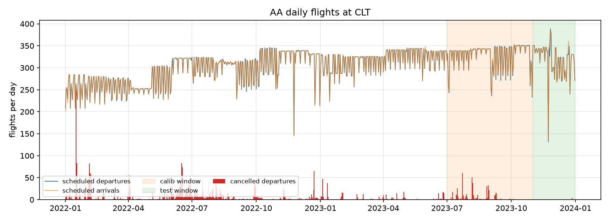

# Phase 1 data quality: AA at CLT

_Generated by `python -m robust_crew.quality`; do not edit by hand._

## Ingest

- BTS months loaded: 24 of 24
- Raw rows read: 13,577,024; rows kept (AA network + all carriers at CLT): 2,142,436
- Row-count parity failures (parsed rows != file lines): none

## Flights table

| rows | date_min | date_max | carrier_rows | carrier_hub_rows | other_carrier_hub_rows | duplicate_flight_ids | unknown_origin_tz | unknown_dest_tz | arr_clock_mismatch |
|---|---|---|---|---|---|---|---|---|---|
| 2142436 | 2022-01-01 | 2023-12-31 | 1814676 | 446023 | 327760 | 0 | 0 | 0 | 7 |

## Daily scheduled departures from the hub

| split | days | mean | min | max | cancelled_pct |
|---|---|---|---|---|---|
| train | 546 | 298.9 | 147 | 346 | 2.0 |
| calib | 123 | 328.6 | 233 | 352 | 1.19 |
| test | 61 | 318.0 | 131 | 389 | 0.03 |

## Outcomes by split (carrier flights touching the hub)

| split | flights | cancelled_pct | diverted_pct | mean_dep_delay_min | arr_del15_pct |
|---|---|---|---|---|---|
| train | 326398 | 2.04 | 0.203 | 14.6 | 22.2 |
| calib | 80837 | 1.22 | 0.224 | 20.4 | 24.5 |
| test | 38788 | 0.04 | 0.134 | 10.1 | 16.7 |

## Missing values, carrier flights touching the hub (%)

| column | all_flights | operated |
|---|---|---|
| Tail_Number | 0.023 | 0.0 |
| CRSDepTime | 0.0 | 0.0 |
| CRSArrTime | 0.0 | 0.0 |
| CRSElapsedTime | 0.0 | 0.0 |
| DepTime | 1.667 | 0.0 |
| DepDelay | 1.667 | 0.0 |
| ArrTime | 1.721 | 0.0 |
| ArrDelay | 1.915 | 0.0 |
| TaxiOut | 1.71 | 0.0 |
| TaxiIn | 1.721 | 0.0 |
| WheelsOff | 1.71 | 0.0 |
| WheelsOn | 1.721 | 0.0 |
| AirTime | 1.915 | 0.0 |
| Distance | 0.0 | 0.0 |
| CarrierDelay | 78.27 | 77.846 |
| LateAircraftDelay | 78.27 | 77.846 |

BTS fills delay-cause columns only for flights arriving 15+ minutes late; nulls elsewhere are expected.

## Weather (IEM ASOS)

Observations: 325,611

| station | obs | first | last | hours_covered | hour_coverage_pct |
|---|---|---|---|---|---|
| PHL | 22084 | 2022-01-01 | 2023-12-31 | 17517 | 99.98 |
| ORD | 21750 | 2022-01-01 | 2023-12-31 | 17517 | 99.98 |
| DCA | 21495 | 2022-01-01 | 2023-12-31 | 17506 | 99.92 |
| BOS | 21275 | 2022-01-01 | 2023-12-31 | 17512 | 99.95 |
| LGA | 20460 | 2022-01-01 | 2023-12-31 | 17515 | 99.97 |
| LAX | 20254 | 2022-01-01 | 2023-12-31 | 17516 | 99.98 |
| DFW | 20252 | 2022-01-01 | 2023-12-31 | 17517 | 99.98 |
| MIA | 20210 | 2022-01-01 | 2023-12-31 | 17516 | 99.98 |
| MCO | 20190 | 2022-01-01 | 2023-12-31 | 17514 | 99.97 |
| TPA | 20137 | 2022-01-01 | 2023-12-31 | 17515 | 99.97 |
| CLT | 20009 | 2022-01-01 | 2023-12-31 | 17395 | 99.29 |
| EWR | 19877 | 2022-01-01 | 2023-12-31 | 17516 | 99.98 |
| RIC | 19829 | 2022-01-01 | 2023-12-31 | 17499 | 99.88 |
| RDU | 19790 | 2022-01-01 | 2023-12-31 | 17515 | 99.97 |
| FLL | 19772 | 2022-01-01 | 2023-12-31 | 17486 | 99.81 |
| PHX | 18227 | 2022-01-01 | 2023-12-31 | 17511 | 99.95 |

Missing values (%):

| tmpf | sknt | gust | vsby | p01i | skyc1 | ceiling_ft | wxcodes |
|---|---|---|---|---|---|---|---|
| 0.02 | 0.13 | 86.38 | 0.02 | 0.15 | 0.02 | 43.39 | 83.22 |

gust, ceiling_ft and wxcodes are null when no gust / no ceiling / no weather is reported
